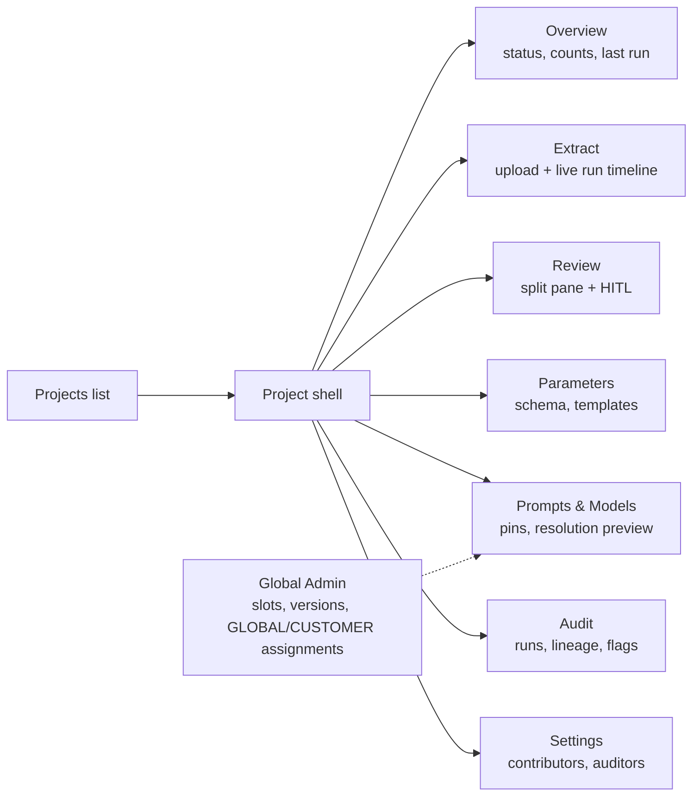
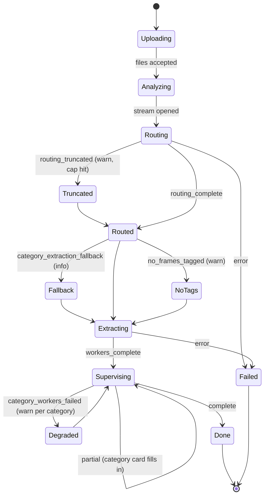
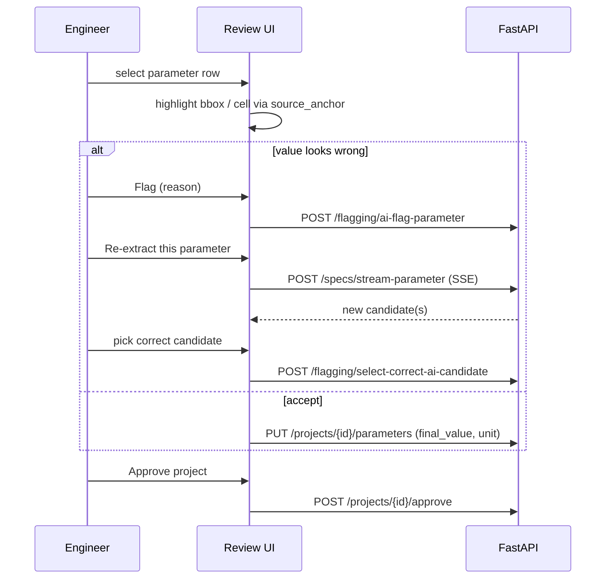
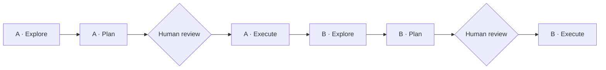

# RFC-FE-01: VV-BDA Frontend Redesign and Feature Wiring

- **Status:** Draft for comment
- **Date:** 2026-10-09
- **Scope:** Next.js/TypeScript frontend (processly-demo), plus the API contracts it needs from the FastAPI backend as of Task 10
- **Inputs:** `Backend_summary_9-10-2026.md`; Mindee reference screenshots in `design/reference/`

---

## 0. Key trade-offs and implicit assumptions

| # | Assumption or trade-off | Why it matters |
|---|---|---|
| A1 | **"Project" in BDA corresponds to "Model" in Mindee.** Each project has its own schema (its `project_parameters`), documents, runs, and pinned prompts. | This decides the navigation: a project-scoped sidebar with a breadcrumb (`Customer › Project alias`). |
| A2 | **There is no real auth** (`/auth` takes a caller-supplied `user_id`). | The frontend must not build role-gated UI that looks secure. Permissions in the UI are cosmetic until real auth lands. |
| A3 | **SSE runs are not resumable.** A page refresh mid-run loses the stream. | This is the biggest UX risk for the Extract screen and needs a small backend addition (§5). |
| A4 | **The storage cleanup lifecycle is undecided.** `GET /documents/{id}/file` can 404 for older projects. | The Review screen must degrade gracefully when the source file is gone. |
| A5 | **Fable is the coding agent and OpenAI is the runtime.** Fable writes the frontend code; the product's runtime LLM calls remain OpenAI-only. | This is consistent with the model constraint. |
| T1 | **Be inspired by Mindee, don't clone it.** Borrow its information architecture, the split-pane review pattern, the guided tour, and the restraint of a dark theme with one accent color. Use your own palette and brand. | It is legally safer, and the battery domain (units, signs, C-rates) needs UI elements Mindee doesn't have. |

---

## 1. What to take from Mindee

| Mindee pattern | BDA equivalent | Backend feature it shows |
|---|---|---|
| Project breadcrumb plus a left sidebar | `Customer › Project alias` | `projects`, `customers` |
| Live Test (drag-and-drop upload) | **Extract**: upload followed by a live run timeline | `POST /files/upload-documents/`, `POST /specs/stream-specs` |
| Documents History tab | **Documents and Runs** tab | `GET /projects/{id}/extraction-runs`, `documents` |
| Data Schema | **Parameters** (the project's live schema plus templates) | `project_parameters`, `/extraction-templates`, save-as-template |
| Continuous Learning (RAG) | **Prompts and Models**: registry, pins, and resolution preview | Prompt admin API, `is_lazy` |
| Webhooks and Documentation | **Audit and Lineage** | `GET /audit/project/{id}/parameter/{key}/lineage` |
| Guided-tour tooltip | Onboarding for the first project | Frontend only |
| Document on the left, fields on the right, with box highlights | **Review**: the PDF bounding box or Excel cell lights up when you select a candidate | `TraceabilityHydrator` (bbox and cell coordinates) |

The last row is the main payoff. The backend already produces Mindee-grade traceability, and today the UI doesn't use it.

---

## 2. Information architecture



`DELETE /system/reset-database` must **never** appear in the UI, not even behind a dev flag.

---

## 3. The Extract screen: the run timeline state machine

Today the frontend recognises only `partial`, `partial_correction`, `refining`, `complete`, and `error`. The redesign turns every backend status into a visible pipeline.



UI rules for this screen:

- **Each `partial` event fills in one category card** (Voltage, Current, Temperature, Capacity, End of Life) as its Supervisor finishes.
- **Warnings are non-terminal banners, not errors.** For example, "cap reached: 200 of 312 assignments kept" explains why some parameters show `not searched: cap reached`.
- **Correction runs reuse the same component** with an `ITERATIVE` or `SINGLE_PARAM` badge.

---

## 4. The Review screen: human-in-the-loop and confidence



### 4.1 Row states

Every row shows exactly one of these states.

| State | Visual | Source |
|---|---|---|
| High confidence (≥ 0.85, tunable) | Neutral | `confidence` |
| Low confidence | Amber, sorted to the top of the queue | `confidence` |
| Auto-flag (out of bounds) | Amber icon labelled "Bounds" | `_flag_out_of_bounds` |
| Human flag (open, or chained) | Red icon showing the flag chain depth | `ai_parameter_flags` |
| Empty with a reason | Grey chip showing one of the 4 reason codes | `reason_codes.py` |
| Human-modified | Pencil, with the original AI value on hover | `is_human_modified` |

Auto-flags and human flags trigger the same correction path in the backend, but they **must look different**. Engineers need to know whether a machine or a colleague raised the doubt.

### 4.2 Battery-domain display rules

- Always show the **original unit as extracted** next to any normalised value (for example, mAh shown beside Ah).
- Show discharge currents (`I_MAX_DCH_*`) as **negative**, with a tooltip explaining the sign convention. Otherwise reviewers will "correct" correct values.
- C-rate values and absolute currents get distinct chips. Never display a converted current without the C-rate basis it came from.
- Show the min/typ/max qualifier as a visible tag, not hidden metadata.

### 4.3 Document viewer trade-off

| Option | Accuracy of highlight | Cost and latency | Edge-case failures |
|---|---|---|---|
| **PDF: pdf.js plus bbox overlay** ✅ | Exact (uses `source_bounding_box`) | Client-side, no extra tokens | Coordinate-origin mismatch between the backend's PDF tooling and pdf.js. Needs one calibration test per PDF producer. |
| PDF: server-rendered page images | Exact | Storage plus render cost | Breaks when cleanup deletes files |
| **Excel: client-side grid from the original file** ✅ | Exact cell, with merged regions preserved | One file fetch | `.xlsm` files must be parsed data-only. Merged header cells must render as merged, or the highlighted cell looks orphaned. |
| Excel: render only the frame text | Approximate | Cheapest | Loses 2-D context. Operating-window matrices (temperature × SOC) become unreadable. |

### 4.4 Edge cases to test against

- **BHV:** multi-sheet workbooks with merged headers. The highlight must resolve to the merged region's anchor cell.
- **CFC:** tables that break across PDF pages. One parameter can carry anchors on two pages, so the viewer must support "jump to anchor 2 of 2".
- **DAM:** scanned or low-quality pages with no reliable bbox. Fall back to a page-level highlight plus the text snippet.
- **NoTP_EB411_Operating_Window (.xlsm):** macro-enabled workbook; parse data-only and verify the matrix layout is preserved.
- **BeglDok_Z65 (EVE D1):** if it contains German labels (e.g. *Nennkapazität*), it is the regression test that the UTF-8 fix holds end to end.

---

## 5. Backend contract gaps the frontend needs

| Gap | Proposal | Priority |
|---|---|---|
| SSE is lost on refresh (A3) | Add a `run_id` to the first SSE event, plus `GET /extraction-runs/{id}/status` returning the last known phase. The frontend reconnects by polling, not by resuming the stream. | **P0** |
| No typed contract | Generate TypeScript types from FastAPI's `/openapi.json`. SSE event payloads need explicit Pydantic models (streaming responses are invisible to OpenAPI). | **P0** |
| Original file may be gone (A4) | `GET /documents/{id}/file` returns a structured `410 { reason: "storage_expired" }`, and the UI shows "source unavailable, values preserved". | P1 |
| Prompt and model admin has no auth | Hide the Global Admin screens behind a feature flag until real auth exists. | P1 |
| Low-confidence queue | Add server-side sorting and filtering on `confidence` and flag state for large projects. | P2 |

### 5.1 About the generated OpenAPI client

FastAPI publishes a machine-readable description of every route at `/openapi.json`. A generator (e.g. `openapi-typescript`) turns it into TypeScript types, so a renamed backend field breaks the frontend build instead of silently rendering blanks.

- **Gap:** SSE event shapes are not in the spec. Hand-type them from the backend summary's SSE table, or add Pydantic models for them in the backend.
- **Gap:** routes returning untyped dicts produce loose types. Task B · Explore lists them.

---

## 6. Delivery plan: 2 tasks × Explore → Plan → Execute

| Task | Scope |
|---|---|
| **A: Redesign** | Visual system, app shell, and every screen, using endpoints that already exist |
| **B: Wiring** | The new backend features: full SSE timeline, flag/correct/select loop, reason codes, prompt pins and `is_lazy`, lineage, plus the backend additions in §5 |



Run A before B so that B's Explore sees the new component structure. Each Execute step works screen by screen, committing and stopping for review after each one.

### Prompt 1: A · Explore (read-only)

```
Read-only task. Do not modify any file.
Context: claude-notes/audit/frontend-rfc.md (target design) and
design/reference/*.png (visual inspiration, Mindee — take layout, density and
interaction patterns; do NOT copy branding, colors, or logo). Read
design/reference/README.md for what to take and leave from each image.
Explore the processly-demo frontend: routing, component library, styling
approach, state management, how SSE is consumed, and which backend endpoints
each screen calls. Write findings to claude-notes/audit/frontend-explore-A.md:
current screen inventory, reusable vs. replaceable components, styling debt,
and every gap between the current UI and the RFC's information architecture.
```

### Prompt 2: A · Plan (no code)

```
Using frontend-explore-A.md, the RFC, and the reference screenshots, write
claude-notes/audit/frontend-plan-A.md: design tokens (dark-first, single
accent of our own), app shell + sidebar + breadcrumb, then one section per
screen (Projects, Overview, Extract, Review, Parameters, Prompts & Models,
Audit, Settings) with components, empty/loading/error states, and which
existing endpoint feeds it. Order the work into reviewable steps. Write no
code. Stop and wait for my approval.
```

### Prompt 3: A · Execute

```
Implement frontend-plan-A.md step by step. After each step: run the build and
tests, commit, write a short note to claude-notes/history/, then stop and
summarize what changed so I can review before the next step. Use existing
endpoints only; where a screen needs data that doesn't exist yet, render a
clearly labeled placeholder — do not invent API fields.
```

### Prompt 4: B · Explore (read-only)

```
Read-only. Read Backend_summary_9-10-2026.md and the RFC §3–§5. Generate the
TypeScript types from the backend's /openapi.json into a scratch location and
compare against the redesigned frontend. Write frontend-explore-B.md listing:
every backend feature not yet surfaced (each SSE status, reason codes,
auto- vs human flags, flag chaining, select-correct-candidate, prompt pins and
is_lazy, resolution preview, lineage, extraction-runs list), every untyped
response, and how source_bounding_box / source_cell_coordinates are shaped.
```

### Prompt 5: B · Plan (no code)

```
Write frontend-plan-B.md: (1) backend additions needed — run_id in the first
SSE event, GET run status for reconnect, Pydantic models for SSE events,
structured 410 for expired source files — as separate backend steps that
follow the BDA repo's CLAUDE.md rules; (2) the generated-client setup;
(3) one wiring step per feature from explore-B, each with its acceptance test.
Battery rules: keep original units visible, discharge currents negative with
explanation, C-rate vs absolute current distinct, min/typ/max shown.
Write no code. Stop and wait for my approval.
```

### Prompt 6: B · Execute

```
Implement frontend-plan-B.md step by step. Backend steps first, in the BDA
repo, tested against bda_test only. Then frontend wiring. After each step:
tests, commit, history note, stop for my review. Verify viewer highlights on
the BHV, CFC and DAM test documents before marking the Review wiring done.
```

---

## Open Design Questions

1. **Confidence threshold:** should it be a single global value, configurable per category (Temperature tends to be messier than Voltage), or tunable per project?
2. **Do we persist SSE events** so a finished run can be replayed in the Audit view, or is a status snapshot enough?
3. **Global Admin placement:** should prompt and model governance live in this app at all, or in a separate internal tool, given there is no auth?
4. **Excel rendering:** parse client-side (fast, but `.xlsm` and merged-cell fidelity are risky), or have the backend emit a normalised grid JSON next to `frames.json` (one source of truth, more storage)?
5. **Storage lifecycle (A4):** which of the four options does the team pick? The Review screen's reliability depends on it more than on any frontend choice.
6. **Approval semantics:** does "Approve" lock the project against further corrections, or only snapshot it?
7. **Should Task B's backend additions be their own Explore → Plan → Execute cycle** in the BDA repo (9 prompts total), keeping backend and frontend reviews separate?
8. **Does processly-demo have its own `CLAUDE.md`?** If not, A · Explore should propose one.
9. **Mock data vs placeholders in Task A:** mock data makes reviews feel more real but risks inventing fields.