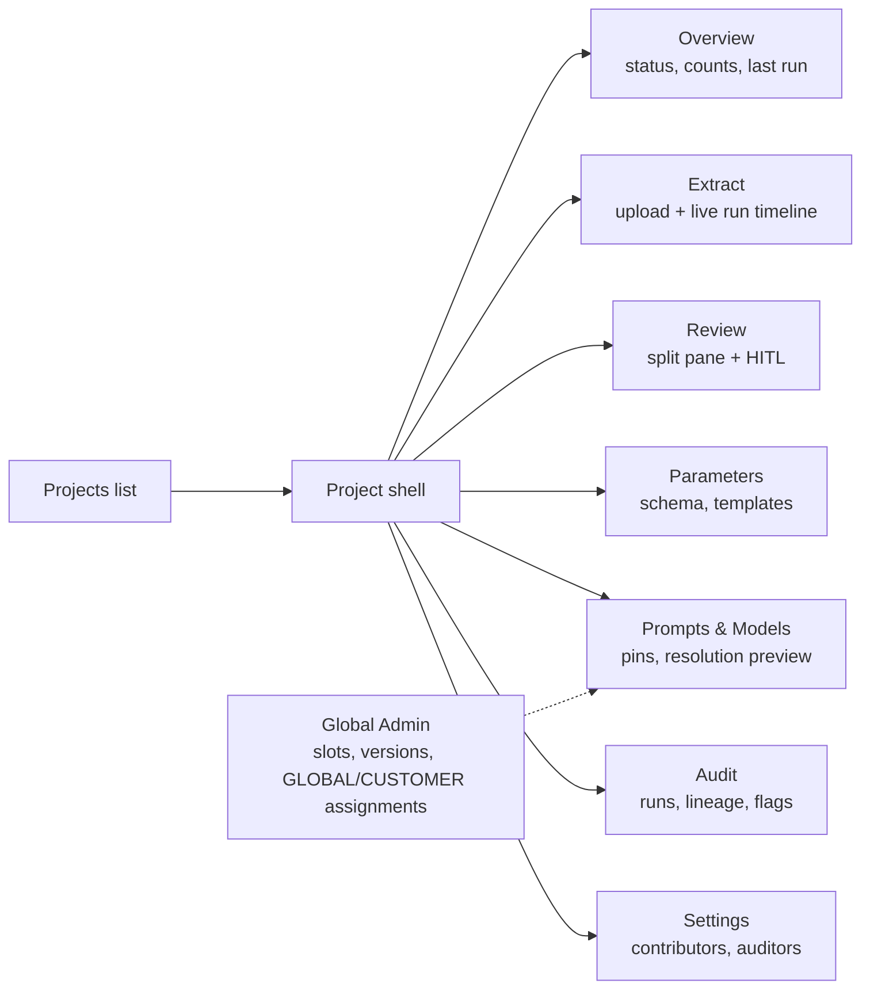
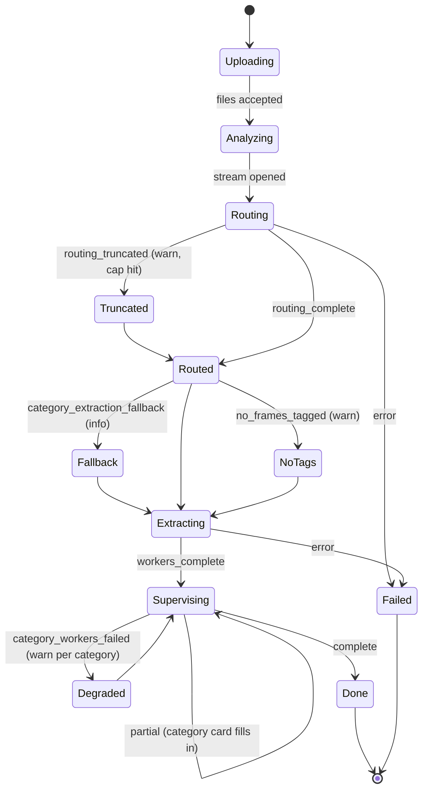
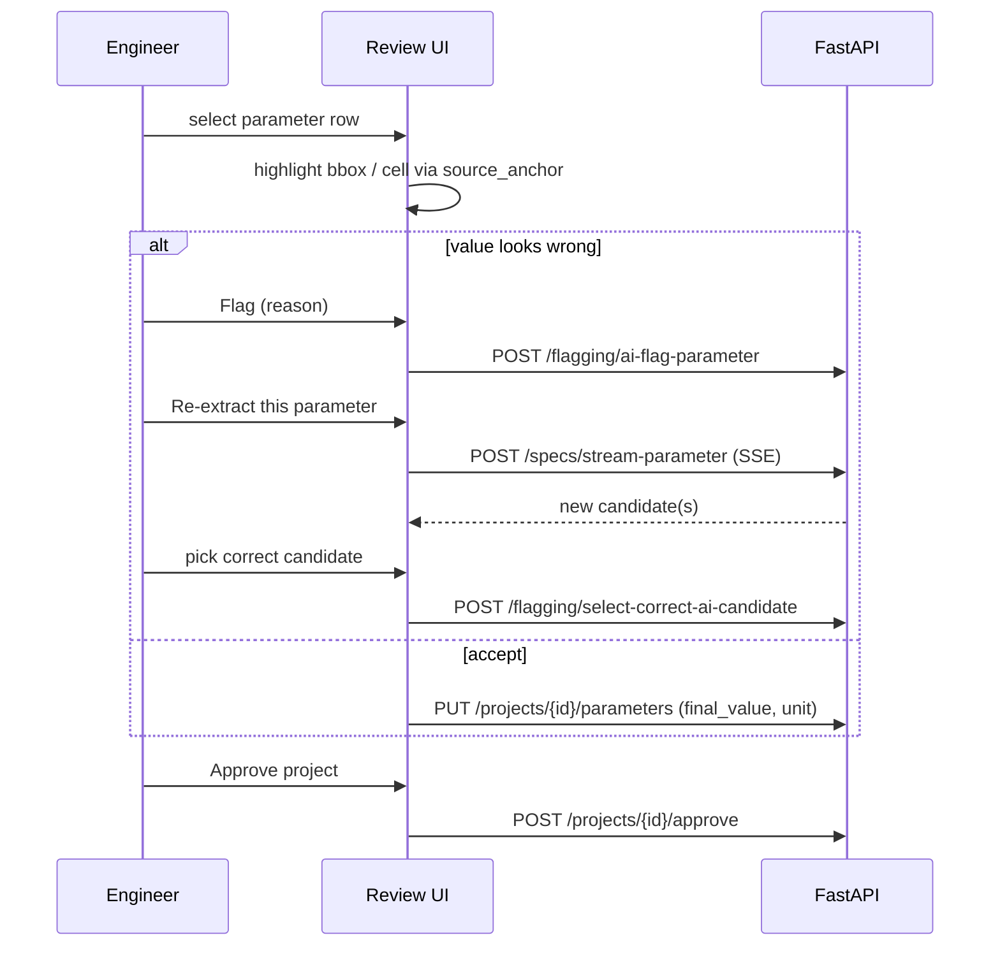
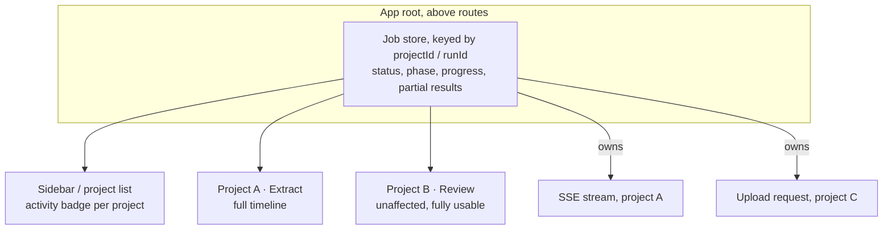
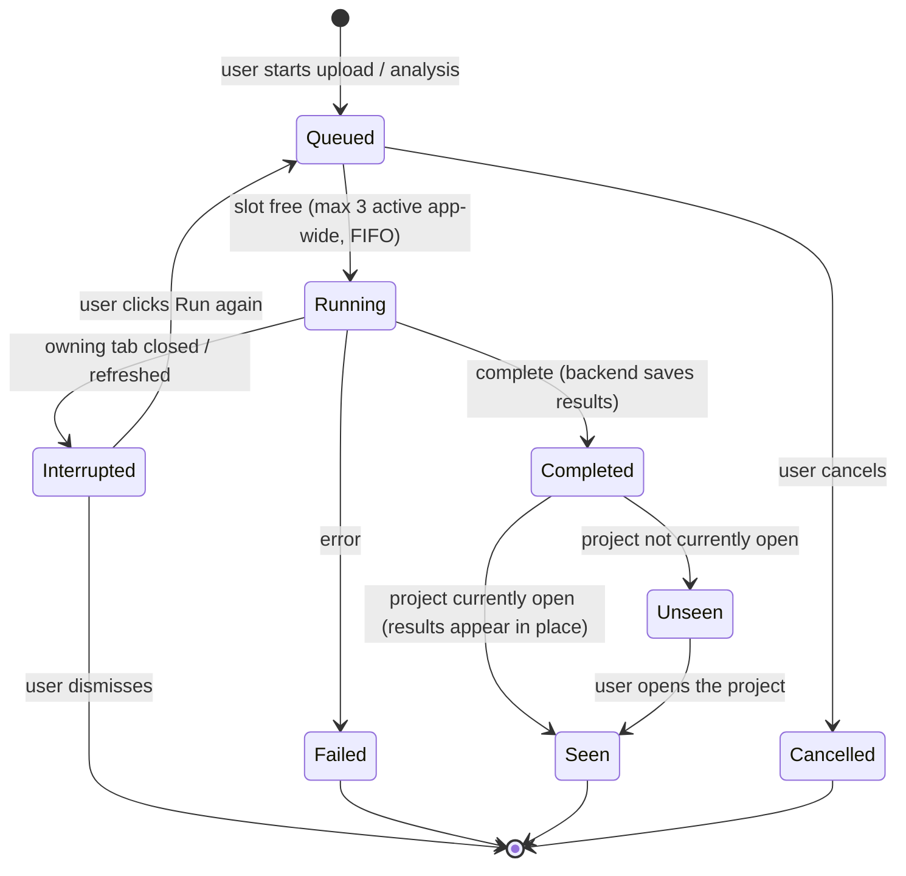
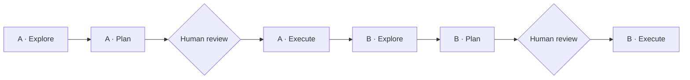

# RFC-FE-01: VV-BDA Frontend Redesign and Feature Wiring

- **Status:** Draft for comment
- **Date:** 2026-10-09
- **Scope:** Next.js/TypeScript frontend (processly-demo), plus the API contracts it needs from the FastAPI backend as of Task 10
- **Inputs:** `Backend_summary_9-10-2026.md`; Mindee reference screenshots in `claude-notes/context/`

---

## 0. Key trade-offs and implicit assumptions

| # | Assumption or trade-off | Why it matters |
|---|---|---|
| A1 | **"Project" in BDA corresponds to "Model" in Mindee.** Each project has its own schema (its `project_parameters`), documents, runs, and pinned prompts. | This decides the navigation: a project-scoped sidebar with a breadcrumb (`Customer › Project alias`). |
| A2 | **There is no real auth** (`/auth` takes a caller-supplied `user_id`). | The frontend must not build role-gated UI that looks secure. Permissions in the UI are cosmetic until real auth lands. |
| A3 | **SSE runs are not resumable.** A page refresh mid-run loses the stream. | This is the biggest UX risk for the Extract screen and needs a small backend addition (§5). |
| A4 | **The storage cleanup lifecycle is undecided.** `GET /documents/{id}/file` can 404 for older projects. | The Review screen must degrade gracefully when the source file is gone. |
| A5 | **Fable is the coding agent and OpenAI is the runtime.** Fable writes the frontend code; the product's runtime LLM calls remain OpenAI-only. | This is consistent with the model constraint. |
| T1 | **Be inspired by Mindee, don't clone it.** Borrow its information architecture, the split-pane review pattern, the guided tour, and the restraint of a dark theme with one accent color. Use your own palette and brand. | It is legally safer, and the battery domain (units, signs, C-rates) needs UI elements Mindee doesn't have. |

---

## 1. What to take from Mindee

| Mindee pattern | BDA equivalent | Backend feature it shows |
|---|---|---|
| Project breadcrumb plus a left sidebar | `Customer › Project alias` | `projects`, `customers` |
| Live Test (drag-and-drop upload) | **Extract**: upload followed by a live run timeline | `POST /files/upload-documents/`, `POST /specs/stream-specs` |
| Documents History tab | **Documents and Runs** tab | `GET /projects/{id}/extraction-runs`, `documents` |
| Data Schema | **Parameters** (the project's live schema plus templates) | `project_parameters`, `/extraction-templates`, save-as-template |
| Continuous Learning (RAG) | **Prompts and Models**: registry, pins, and resolution preview | Prompt admin API, `is_lazy` |
| Webhooks and Documentation | **Audit and Lineage** | `GET /audit/project/{id}/parameter/{key}/lineage` |
| Guided-tour tooltip | Onboarding for the first project | Frontend only |
| Document on the left, fields on the right, with box highlights | **Review**: the PDF bounding box or Excel cell lights up when you select a candidate | `TraceabilityHydrator` (bbox and cell coordinates) |

The last row is the main payoff. The backend already produces Mindee-grade traceability, and today the UI doesn't use it.

---

## 2. Information architecture



`DELETE /system/reset-database` must **never** appear in the UI, not even behind a dev flag.

---

## 3. The Extract screen: the run timeline state machine

Today the frontend recognises only `partial`, `partial_correction`, `refining`, `complete`, and `error`. The redesign turns every backend status into a visible pipeline.



UI rules for this screen:

- **Each `partial` event fills in one category card** (Voltage, Current, Temperature, Capacity, End of Life) as its Supervisor finishes.
- **Warnings are non-terminal banners, not errors.** For example, "cap reached: 200 of 312 assignments kept" explains why some parameters show `not searched: cap reached`.
- **Correction runs reuse the same component** with an `ITERATIVE` or `SINGLE_PARAM` badge.

---

## 4. The Review screen: human-in-the-loop and confidence



### 4.1 Row states

Every row shows exactly one of these states.

| State | Visual | Source |
|---|---|---|
| High confidence (≥ 0.85, tunable) | Neutral | `confidence` |
| Low confidence | Amber, sorted to the top of the queue | `confidence` |
| Auto-flag (out of bounds) | Amber icon labelled "Bounds" | `_flag_out_of_bounds` |
| Human flag (open, or chained) | Red icon showing the flag chain depth | `ai_parameter_flags` |
| Empty with a reason | Grey chip showing one of the 4 reason codes | `reason_codes.py` |
| Human-modified | Pencil, with the original AI value on hover | `is_human_modified` |

Auto-flags and human flags trigger the same correction path in the backend, but they **must look different**. Engineers need to know whether a machine or a colleague raised the doubt.

### 4.2 Battery-domain display rules

- Always show the **original unit as extracted** next to any normalised value (for example, mAh shown beside Ah).
- Show discharge currents (`I_MAX_DCH_*`) as **negative**, with a tooltip explaining the sign convention. Otherwise reviewers will "correct" correct values.
- C-rate values and absolute currents get distinct chips. Never display a converted current without the C-rate basis it came from.
- Show the min/typ/max qualifier as a visible tag, not hidden metadata.

### 4.3 Document viewer trade-off

| Option | Accuracy of highlight | Cost and latency | Edge-case failures |
|---|---|---|---|
| **PDF: pdf.js plus bbox overlay** ✅ | Exact (uses `source_bounding_box`) | Client-side, no extra tokens | Coordinate-origin mismatch between the backend's PDF tooling and pdf.js. Needs one calibration test per PDF producer. |
| PDF: server-rendered page images | Exact | Storage plus render cost | Breaks when cleanup deletes files |
| **Excel: client-side grid from the original file** ✅ | Exact cell, with merged regions preserved | One file fetch | `.xlsm` files must be parsed data-only. Merged header cells must render as merged, or the highlighted cell looks orphaned. |
| Excel: render only the frame text | Approximate | Cheapest | Loses 2-D context. Operating-window matrices (temperature × SOC) become unreadable. |

### 4.4 Edge cases to test against

- **BHV:** multi-sheet workbooks with merged headers. The highlight must resolve to the merged region's anchor cell.
- **CFC:** tables that break across PDF pages. One parameter can carry anchors on two pages, so the viewer must support "jump to anchor 2 of 2".
- **DAM:** scanned or low-quality pages with no reliable bbox. Fall back to a page-level highlight plus the text snippet.
- **NoTP_EB411_Operating_Window (.xlsm):** macro-enabled workbook; parse data-only and verify the matrix layout is preserved.
- **BeglDok_Z65 (EVE D1):** if it contains German labels (e.g. *Nennkapazität*), it is the regression test that the UTF-8 fix holds end to end.

---

## 5. Backend contract gaps the frontend needs

| Gap | Proposal | Priority |
|---|---|---|
| SSE is lost on refresh (A3) | Add a `run_id` to the first SSE event, plus `GET /extraction-runs/{id}/status` returning the last known phase. The frontend reconnects by polling, not by resuming the stream. | **P0** |
| No typed contract | Generate TypeScript types from FastAPI's `/openapi.json`. SSE event payloads need explicit Pydantic models (streaming responses are invisible to OpenAPI). | **P0** |
| Original file may be gone (A4) | `GET /documents/{id}/file` returns a structured `410 { reason: "storage_expired" }`, and the UI shows "source unavailable, values preserved". | P1 |
| Prompt and model admin has no auth | Hide the Global Admin screens behind a feature flag until real auth exists. | P1 |
| Low-confidence queue | Add server-side sorting and filtering on `confidence` and flag state for large projects. | P2 |

### 5.1 About the generated OpenAPI client

FastAPI publishes a machine-readable description of every route at `/openapi.json`. A generator (e.g. `openapi-typescript`) turns it into TypeScript types, so a renamed backend field breaks the frontend build instead of silently rendering blanks.

- **Gap:** SSE event shapes are not in the spec. Hand-type them from the backend summary's SSE table, or add Pydantic models for them in the backend.
- **Gap:** routes returning untyped dicts produce loose types. Task B · Explore lists them.

---

## 5b. Cross-cutting requirements (added 2026-10-09)

### 5b.1 Project-scoped background work

**Problem today:** pressing Analyze or uploading locks the whole app; the user cannot switch projects.

**Root cause (assumed, to be confirmed in A · Explore):** loading and stream state live inside the page component. When it is the only owner, either the UI must block, or navigating away unmounts it and kills the stream.



| Option | Accuracy of state | Cost / latency | Edge-case failures |
|---|---|---|---|
| **A. App-level job store owns the streams** ✅ (Task A) | Exact while the tab is open | No backend change | Lost on page refresh. Browser connection limit (~6 per origin over HTTP/1.1) when many projects stream at once. |
| **B. Backend background job + run status endpoint** ✅ (Task B, RFC §5 P0) | Survives refresh and multiple tabs | Small backend change | Needs `run_id` early in the stream and a status route |
| C. Block the UI (today) | — | — | Rejected |

**Decision:** do A in Task A, B in Task B. A is designed so that B swaps in behind the same store interface.

#### Job lifecycle and concurrency rules (decided 2026-10-09)



| Rule | Detail |
|---|---|
| Cap | At most **3 active jobs** app-wide; uploads and extractions both count. One config constant. |
| Opening projects | Never capped. At the cap, every project stays fully browsable and reviewable. |
| Queueing | A job started at the cap is queued: "Queued, position N" inside that project, with cancel. Starts automatically, first in, first out. |
| Completion | **Never navigates.** The project's data refreshes in the background; the project gets a "new results" badge, plus at most a small non-blocking notification with an optional "Open" action. |
| Failure | Error badge on the project; details inside it; nothing else is interrupted. |
| Scope of the cap | **Per browser**, shared by all tabs through browser storage and a cross-tab channel. Exactly one tab owns each running job. |
| Refresh | **Queued jobs survive** a refresh (stored locally; upload files kept in IndexedDB until uploaded or cancelled). **Running jobs do not auto-restart**: they become "Interrupted" with a "Run again" action, because a re-run costs tokens and creates a new extraction run. |

| Trade-off (per browser vs per tab) | Detail |
|---|---|
| Per browser ✅ | Matches the real constraint (connections are shared by all tabs) and what the user sees. Needs cross-tab coordination, which is more work than it sounds: two tabs must not both start the same queued job. |
| Per tab | Simplest to build, but 3 tabs could open 9 streams and exhaust the browser's connections. Rejected. |

**Risk to confirm in Task B:** results are saved by the backend only when the stream reaches `complete`. If the browser tab is closed mid-run, the backend likely stops the stream and saves nothing. This is acceptable for Task A (the job store keeps streams alive while the tab is open) and is fixed properly by option B, where the run continues server-side.

### 5b.2 Categories are data, including End of Life

The old frontend hardcodes 4 categories in `SCHEMA_GROUPS`, so `END_OF_LIFE` (added in backend Task 7) never appears. The backend's `parameters.category` is free text by design, so new categories can appear without code changes.

Rule: group by each parameter's `category` from the project. Keep a display-order and label map for the 5 known categories; append unknown categories with a humanised label rather than dropping them. Empty categories still render, showing their reason codes.

### 5b.3 Dark and light mode

| Decision | Detail |
|---|---|
| Token model | Every semantic token (surface, text, border, accent, status colors) has a light and a dark value, defined once in the MUI v7 theme. No raw color imports in components. |
| Default and persistence | Follow the OS preference. Main control in **Settings** (Light / Dark / System), plus a **quick toggle** in the shell header. Persist to backend `user_settings.theme` when a user is known, otherwise locally. |
| References | Mindee screenshots in both modes in `claude-notes/context/`, used for how each mode handles surfaces and contrast. |
| Documents stay light | PDF pages and spreadsheet grids are the document and stay light in both modes. Highlight overlays must have strong contrast on white in both modes. |
| Status colors | Confidence, auto-flag, human-flag and reason-code chips must be distinguishable in both modes and always paired with an icon or label. |

### 5b.4 Design and interaction quality bar

The redesign should feel noticeably better than the reference, not just restyled:

- **Every interactive component** has hover, focus-visible, pressed, disabled and loading states, and works by keyboard.
- **Skeletons** for known layouts instead of spinners; **empty and error states** always offer a next action.
- **Short, purposeful motion** (≤ 200 ms): category cards filling in during a run, the highlight gliding to a source anchor, panels resizing. Disabled under `prefers-reduced-motion`.
- **Review is keyboard-first:** next/previous parameter, accept, flag, and jump-to-source without the mouse. This is where engineers spend their time.
- **Density options** for the parameter table (comfortable / compact), since some projects have dozens of parameters.
- Every screen is checked in **both modes** at desktop and laptop widths before a step is done.
- **Deferred:** a command palette / global keyboard launcher is out of scope for now.

---

## 6. Delivery plan: 2 tasks × Explore → Plan → Execute

| Task | Scope |
|---|---|
| **A: Redesign** | Visual system, app shell, and every screen, using endpoints that already exist |
| **B: Wiring** | The new backend features: full SSE timeline, flag/correct/select loop, reason codes, prompt pins and `is_lazy`, lineage, plus the backend additions in §5 |



Run A before B so that B's Explore sees the new component structure. Each Execute step works screen by screen, committing and stopping for review after each one.

### Prompt 1: A · Explore (read-only)

```
Read-only session for source code. Read CLAUDE.md first and follow §0 and §1.
Then read claude-notes/context/fe_rfc.md and view every image in
claude-notes/context/ (Mindee reference: take layout, density, navigation,
dropzone, split-pane review and guided-tour patterns; do not copy branding,
logo or the red accent).

Explore this repo: routing, components, the two document viewers, the hooks,
the api/ layer, the theme, and how SSE is consumed (if at all). Compare the
api/ layer against claude-notes/context/openapi.json.

Write claude-notes/plans/explore-A.md with:
1. Screen and component inventory: keep / extend / replace, with reasons
2. Every gap between the current app and the RFC's information architecture (§2)
3. Every api/ call that no longer matches openapi.json
4. Styling debt (direct color imports vs MUI palette, dark-only colors, etc.)
5. Root cause of the app-wide loading lock: exactly where upload/analysis
   loading state lives and why it blocks switching projects (RFC §5b.1)
6. Everywhere categories are hardcoded (SCHEMA_GROUPS and any other place)
7. Risks and open questions for the plan

Then write your history note and stop.
```

### Prompt 2: A · Plan (no code)

```
Read CLAUDE.md, fe_rfc.md, the reference images, and claude-notes/plans/explore-A.md.
Write claude-notes/plans/plan-A.md. Write no source code.

Include:
1. Design tokens for BOTH light and dark mode (our own single accent color,
   typography, spacing, radius, elevation, motion), mapped onto the MUI v7
   theme; OS default + toggle + persistence per CLAUDE.md §8.3
2. A component library section: every shared component with its states per
   CLAUDE.md §8.4, and the interactions that should feel better than the
   reference (RFC §5b.4)
3. App shell: project-scoped sidebar with per-project activity badges,
   breadcrumb (Customer › Project), routes per RFC §2, Projects list backed
   by /projects (no client-side UUIDs)
4. The project-scoped job store (RFC §5b.1, CLAUDE.md §8.1): where it lives,
   what it holds, how uploads and streams are owned by it, the 3-job cap with
   a FIFO queue and cancel, background refresh on completion with no
   navigation, the "new results" / error badges, the per-browser cap shared
   across tabs, the queue persisted across refresh (upload files in
   IndexedDB), the "Interrupted" state for running jobs, and how Task B's
   run-status endpoint will plug in behind the same interface
5. Category grouping from project data, including END_OF_LIFE and unknown
   categories (RFC §5b.2)
6. One section per screen: components, empty/loading/error states, the exact
   openapi.json route(s), or "placeholder" if none exists
7. What happens to the existing viewers and hooks (extend, don't rewrite,
   unless explore-A shows a strong reason)
8. An ordered list of steps, each small enough to review in one sitting.
   Steps 1–3 must be: tokens + both modes, job store, app shell.

Write your history note and stop for my approval.
```

### Prompt 3: A · Execute

```
Implement claude-notes/plans/plan-A.md, starting at step 1.
Follow CLAUDE.md §0 and §1 exactly: one step at a time; build + lint must
pass; commit; history note; then stop and summarize for my review.
Every step must meet CLAUDE.md §8 (project-scoped loading, categories from
data, both color modes, component quality bar); say in the history note how
you checked each one that applies.
Never invent API fields; use labelled placeholders where plan-A says so.
Update CLAUDE.md §5 when a step changes the architecture.
```

### Prompt 4: B · Explore (read-only)

```
Read-only for source code. Read CLAUDE.md, fe_rfc.md §3–§5b,
claude-notes/plans/plan-A.md and the latest history notes. Compare the
redesigned frontend against claude-notes/context/openapi.json.

Write claude-notes/plans/explore-B.md listing:
1. Every backend feature not yet surfaced: each SSE status, the 4 reason codes,
   auto- vs human flags, flag chaining, select-correct-candidate, prompt pins
   and is_lazy, resolution preview, lineage, extraction-runs list
2. Every route whose response schema is untyped or loose in openapi.json
3. The exact shapes of source_bounding_box and source_cell_coordinates, and
   whether the current viewers handle them
4. How the Task A job store currently owns streams, and what must change for
   the run-status endpoint (RFC §5b.1 option B)
5. Which RFC §5 backend additions are still needed

Write your history note and stop.
```

### Prompt 5: B · Plan (no code)

```
Read CLAUDE.md, fe_rfc.md, claude-notes/plans/explore-B.md and the recent
history notes. Write claude-notes/plans/plan-B.md. Write no source code.

Include:
1. Backend additions (in the BDA repo, following its own CLAUDE.md): run_id in
   the first SSE event, a run-status endpoint for reconnect, Pydantic models for
   SSE events, a structured 410 for expired source files. Each as its own step
   with an acceptance test against bda_test.
2. Generated TypeScript client from openapi.json, plus hand-written SSE event types
3. Swapping the job store onto the run-status endpoint behind its existing
   interface, so runs survive a page refresh
4. One wiring step per feature in explore-B, each with acceptance criteria
5. The battery display rules in CLAUDE.md §7 and the §8 requirements as
   explicit acceptance checks

Write your history note and stop for my approval.
```

### Prompt 6: B · Execute

```
Implement claude-notes/plans/plan-B.md step by step. Backend steps first, in
the BDA repo, following that repo's CLAUDE.md (tests against bda_test only;
migrations additive with a working down block). Then the frontend wiring.
Follow this repo's CLAUDE.md §0 and §1 after every step and stop for my review.
Before marking the Review wiring done, verify highlights on the BHV, CFC and
DAM test documents in both light and dark mode, and record the results in the
history note.
```

---

## Open Design Questions

1. **Confidence threshold:** should it be a single global value, configurable per category (Temperature tends to be messier than Voltage), or tunable per project?
2. **Do we persist SSE events** so a finished run can be replayed in the Audit view, or is a status snapshot enough?
3. **Global Admin placement:** should prompt and model governance live in this app at all, or in a separate internal tool, given there is no auth?
4. **Excel rendering:** parse client-side (fast, but `.xlsm` and merged-cell fidelity are risky), or have the backend emit a normalised grid JSON next to `frames.json` (one source of truth, more storage)?
5. **Storage lifecycle (A4):** which of the four options does the team pick? The Review screen's reliability depends on it more than on any frontend choice.
6. **Approval semantics:** does "Approve" lock the project against further corrections, or only snapshot it?
7. **Should Task B's backend additions be their own Explore → Plan → Execute cycle** in the BDA repo (9 prompts total), keeping backend and frontend reviews separate?
8. **Does processly-demo have its own `CLAUDE.md`?** If not, A · Explore should propose one.
9. **Mock data vs placeholders in Task A:** mock data makes reviews feel more real but risks inventing fields.